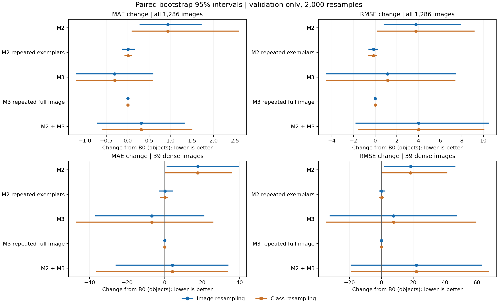
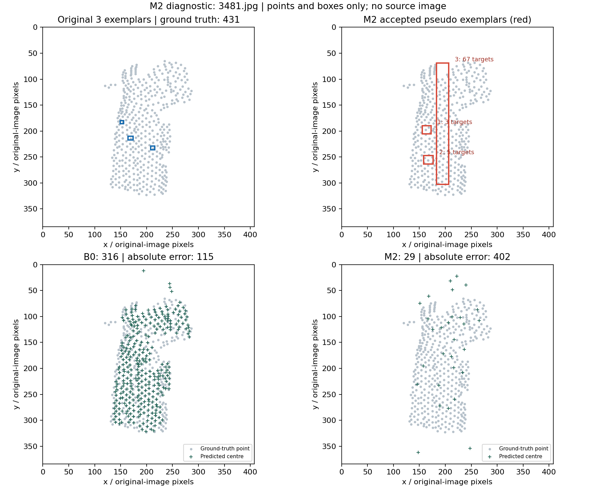

# M2／M3 第一輪實驗結果

日期：2026-10-18。設定：`m2-m3-v1`。所有數值由實際逐圖預測產生，並通過獨立核算。

目前已完成並核算 5／5 組。完整結果如下。

我們沿用凍結的 GeCo2／SAM2 官方權重，在 FSC-147 官方 val 的全部 1,286 張圖片比較。輸入為單張 RGB 圖及官方前三個示例框；真值採官方點標註的個數，共 82,042 個物件，每圖中位數 27、平均 63.80 個，範圍 7–2,092。MAE 是每張圖計數誤差的絕對值平均；例如 9.39 表示平均相差約 9.39 個，不代表每張都只差 9 個。RMSE 對嚴重失誤較敏感；兩者不是百分比。這輪沒有訓練，也沒有執行 test。

本輪保留 B0／M1 作為工作基準。五組都未同時達到事前門檻；M2 新尺度示例整體退步，M3 雖降低平均及密集組誤差，卻增加對嚴重失誤敏感的 RMSE，配對區間也跨過零。M2＋M3 未修復這個取捨，不採用為預設流程。

這是目前固定設定的負結果與混合結果，尚不能據此否定所有補充示例或切片方法。接下來應先釐清失敗機制；M4 訓練仍未開始。

## 整體與密集圖片

| 方法 | MAE | RMSE | ≥300 個組 MAE（39 圖） | GAME(1)／GAME(2) | 主循環秒數 | allocated 峰值 MiB |
|---|---:|---:|---:|---:|---:|---:|
| B0／M1 基準 | 9.390 | 33.263 | 113.436 | 11.91／15.56 | 184.0 | 5517 |
| M2 新尺度示例 | 10.323 | 37.026 | 131.103 | 12.73／16.37 | 211.4 | 5261 |
| M2 重複示例對照 | 9.396 | 33.118 | 113.641 | 11.95／15.59 | 207.8 | 5262 |
| M3 重疊切片 | 9.086 | 34.415 | 106.564 | 11.31／14.90 | 273.2 | 5261 |
| M3 重複全圖對照 | 9.390 | 33.263 | 113.436 | 11.91／15.56 | 306.4 | 5429 |
| M2＋M3 | 9.705 | 37.275 | 117.590 | 11.88／15.47 | 299.0 | 5261 |

GAME 是將圖片分成 2×2 或 4×4 網格後，各區計數誤差的總和再對圖片平均。密度圖由檢測框生成並守恆，未訓練密度分支。時間是單次作業的完整主循環，不含環境安裝和模型初始化；各組流程開銷不同，不能把它當成嚴格 FLOPs 比較。

## 配對差值與判讀

以下差值均為「新方法 − B0」，負值較好。95% 區間各重抽樣 2,000 次；圖片配對與類別配對分開列出。類別重抽樣保留該類別全部圖片的權重。這是開發用 val，不是獨立確認，也沒有校正多組比較。

| 方法 | MAE 差值 | 圖片配對 95% 區間 | 類別配對 95% 區間 | RMSE 差值 | 通過本輪候選門檻 |
|---|---:|---|---|---:|---|
| M2 新尺度示例 | +0.934 | +0.28 至 +1.71 | +0.10 至 +2.58 | +3.763 | 否 |
| M2 重複示例對照 | +0.006 | -0.13 至 +0.15 | -0.06 至 +0.08 | -0.145 | 否 |
| M3 重疊切片 | -0.303 | -1.20 至 +0.58 | -1.19 至 +0.58 | +1.152 | 否 |
| M3 重複全圖對照 | +0.000 | +0.00 至 +0.00 | +0.00 至 +0.00 | +0.000 | 否 |
| M2＋M3 | +0.315 | -0.70 至 +1.32 | -0.59 至 +1.49 | +4.012 | 否 |

下圖同時呈現全體及密集組的 MAE／RMSE 差值與區間；橫軸零為 B0，左側較好，線段跨零表示本次重抽樣同時容許改善或退步。

候選門檻為：整體 MAE 不超過 B0 的 102%，同時 RMSE 和密集組 MAE 都下降；還須看對照及區間，不能僅憑此表宣布穩定改善。

## 觸發與失敗線索

| 方法 | M2 觸發圖數 | M3 觸發圖數 | 改善／退步／誤差不變圖數 |
|---|---:|---:|---:|
| M2 新尺度示例 | 211 | 0 | 70／91／1125 |
| M2 重複示例對照 | 211 | 0 | 56／48／1182 |
| M3 重疊切片 | 0 | 135 | 69／47／1170 |
| M3 重複全圖對照 | 0 | 135 | 0／0／1286 |
| M2＋M3 | 211 | 136 | 129／118／1039 |

M2 新尺度示例 共選出 228 個候選示例，其中 217 個框含至少一個官方目標點，53 個含多個點。這是候選品質的代理檢查，不等同人工確認語意正確；多物件框可能混淆示例，不能直接當成可靠單一物件。

M2＋M3 共選出 228 個候選示例，其中 217 個框含至少一個官方目標點，53 個含多個點。這是候選品質的代理檢查，不等同人工確認語意正確；多物件框可能混淆示例，不能直接當成可靠單一物件。

以 `3481.jpg` 為例，真值 431 個，B0 預測 316，M2 預測 29。一個通過篩選的增補框包住了 67 個標註點；高外觀相似度仍可能選到整段圖案。這是事後診斷，沒有據此更動本輪參數。下圖只畫標註點、示例框及檢測中心，沒有使用資料集原圖。

## M3 兩張極端案例的流程診斷

五組評估完成後，才對 M3 最大退步與最大改善各一張加上唯讀記錄。兩張重跑的最終框皆與正式結果逐位元相同，沒有更動模型或參數。表內「候選」是 SAM 遮罩修正之前的數量，與逐圖檔案中已做片內後處理的 `raw_count` 不同。

| 圖片 | 真值 | B0 → M3 | 全圖候選 | 四片各自候選 | 核心區歸屬後合計 | 最後跨片 NMS 移除 |
|---|---:|---:|---:|---|---:|---:|
| 865.jpg | 1022 | 787 → 490 | 1017 | 223／298／360／343 | 490 | 0 |
| 3665.jpg | 907 | 1179 → 897 | 1210 | 300／535／405／693 | 899 | 2 |

兩張的全圖候選都超過上游的 800 門檻而略過 SAM 遮罩修正，各裁片則均進入修正。因此切片同時改變尺度、上下文和遮罩執行分支，不能將結果只歸因於「放大圖片」。`865.jpg` 在最後跨片 NMS 沒有移除任何框，故該步並非這張大量漏計的直接來源；這不排除片內後處理、核心區歸屬或特徵尺度的影響。

同樣的分支變化出現在一張大幅改善和一張大幅退步的圖片，仍不足以證明遮罩修正是原因。這兩張是事後挑出的極端案例，不能當成普遍發生比例。原始記錄見 [trace_diagnostics.json](../results/m2-m3-v1/trace_diagnostics.json)。

各組最大改善／退步案例及類別、完整密度分組指標與區間保存在對應 `analysis.json`／`summary.json`。推論策略的輸入沒有真值；目標點只在推論結束後作計分與候選品質檢查。

## 可核對證據

原模型與新介面在涵蓋三種密度的 32 張圖上，原始框、objectness、SAM 分數逐位元相同；最終框與保存的 B0 相同。每一個完整實驗又逐圖核對第一輪框與 B0 完全一致。密度／幾何及統計共 11 項 CPU 測試通過；完整輸出再次對照原始真值、指標和檔案雜湊。

- M2 新尺度示例：[摘要](../results/m2-m3-v1/val-m2/summary.json)、[獨立核算與配對區間](../results/m2-m3-v1/val-m2/analysis.json)、[逐圖預測](../results/m2-m3-v1/val-m2/predictions.jsonl)、[執行設定](../results/m2-m3-v1/val-m2/protocol.json)
- M2 重複示例對照：[摘要](../results/m2-m3-v1/val-m2-repeat/summary.json)、[獨立核算與配對區間](../results/m2-m3-v1/val-m2-repeat/analysis.json)、[逐圖預測](../results/m2-m3-v1/val-m2-repeat/predictions.jsonl)、[執行設定](../results/m2-m3-v1/val-m2-repeat/protocol.json)
- M3 重疊切片：[摘要](../results/m2-m3-v1/val-m3/summary.json)、[獨立核算與配對區間](../results/m2-m3-v1/val-m3/analysis.json)、[逐圖預測](../results/m2-m3-v1/val-m3/predictions.jsonl)、[執行設定](../results/m2-m3-v1/val-m3/protocol.json)
- M3 重複全圖對照：[摘要](../results/m2-m3-v1/val-m3-repeat/summary.json)、[獨立核算與配對區間](../results/m2-m3-v1/val-m3-repeat/analysis.json)、[逐圖預測](../results/m2-m3-v1/val-m3-repeat/predictions.jsonl)、[執行設定](../results/m2-m3-v1/val-m3-repeat/protocol.json)
- M2＋M3：[摘要](../results/m2-m3-v1/val-m2-m3/summary.json)、[獨立核算與配對區間](../results/m2-m3-v1/val-m2-m3/analysis.json)、[逐圖預測](../results/m2-m3-v1/val-m2-m3/predictions.jsonl)、[執行設定](../results/m2-m3-v1/val-m2-m3/protocol.json)

## 與對照組的直接比較

| 比較（前者 − 後者） | MAE 差值 | 圖片配對 95% 區間 | 類別配對 95% 區間 |
|---|---:|---|---|
| M2 新尺度示例 − M2 重複示例對照 | +0.928 | +0.27 至 +1.71 | +0.09 至 +2.54 |
| M3 重疊切片 − M3 重複全圖對照 | -0.303 | -1.20 至 +0.58 | -1.19 至 +0.58 |
| M2＋M3 − M2 新尺度示例 | -0.619 | -1.47 至 +0.20 | -1.94 至 +0.44 |
| M2＋M3 − M3 重疊切片 | +0.618 | -0.03 至 +1.33 | +0.04 至 +1.51 |

對照組控制示例數或推論次數，仍有特徵和遮罩候選數差異；完整配對資料見 [contrasts.json](../results/m2-m3-v1/contrasts.json)。

## 執行範圍與下一步

五組各完成 1,286 張，共 6,430 次正式圖片評估。全部完成且沒有 OOM；allocated 峰值最高 5429 MiB，reserved 峰值最高 8514 MiB。這證明目前單圖循序推論在現有 GPU 可執行，不能外推為 M4 訓練或較大 batch 的容量保證。

目前建議依下列順序繼續，尚未執行新的設定：

1. 保留 B0，先為 M3 設計一個有界的遮罩分支對照：固定裁片、示例及閾值，只比較遮罩修正前後的計數與定位，釐清效果是否受上游 800 候選分支影響。新規則及預算須先寫入下一版實驗方案，不能把本輪發現回寫成事前假設。
2. M2 暫不併入主流程。若繼續研究，先處理多物件候選及示例可靠性，再檢查計數；不能在推論時用真值點過濾候選。高相似度或高 objectness 本身不足以證明是單一物件。
3. 進入 M4 時先以乾淨的 B0 特徵訓練密度分支，保留與官方計數的獨立比較；有新增證據後才考慮與 M2／M3 組合。

本輪的 29 個 val 類別、密度與示例尺寸分組提供了限定範圍內的證據；密集組只有 39 張、9 類，區間較寬。尚無最終 test 或外部資料集確認，不能宣稱新增方法已普遍提升未見類別或跨場景魯棒性。類別及觸發條件的事後細分見 [diagnostics.json](../results/m2-m3-v1/diagnostics.json)，其中分組會重疊。

方法、事前規則與限制見 [M2／M3 規則](M2_M3_PROTOCOL.md)，原基準見 [B0 結果](B0_RESULTS.md)。未以不佳結果為由修改閾值，也未選取部分圖片作為正式結果。
